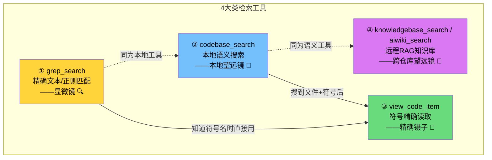
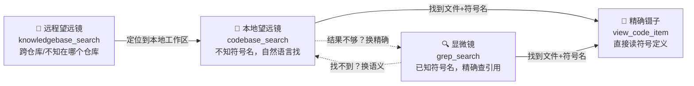
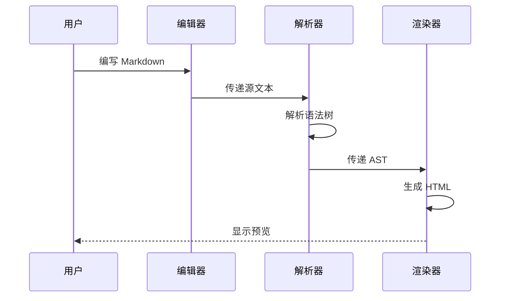
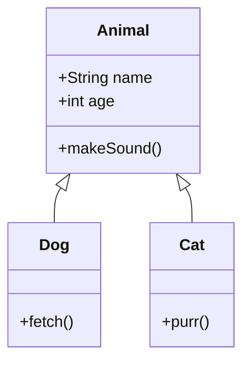
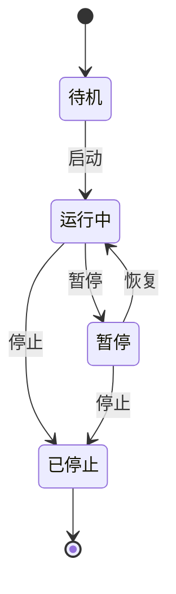
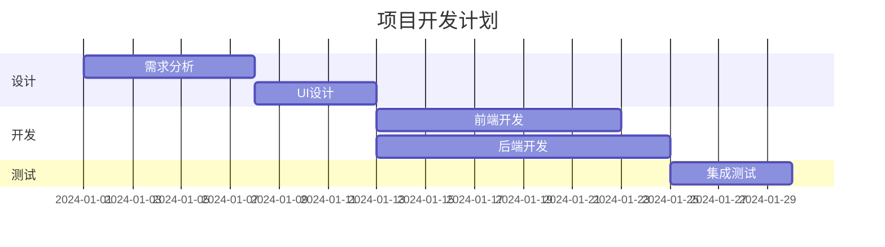
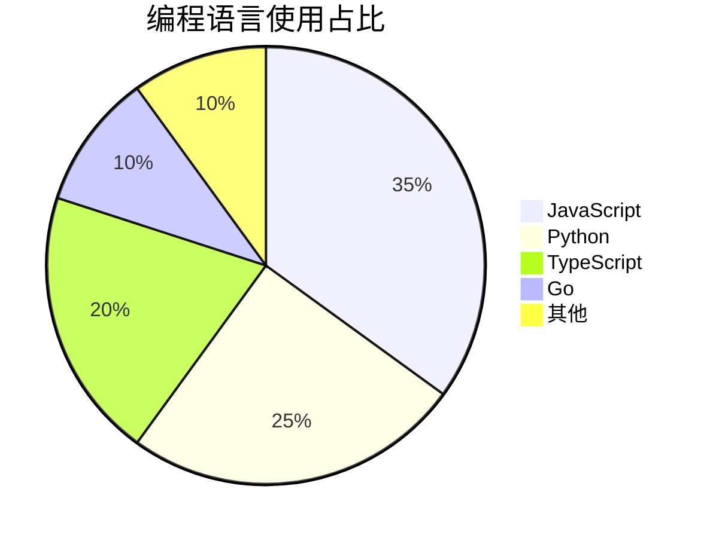
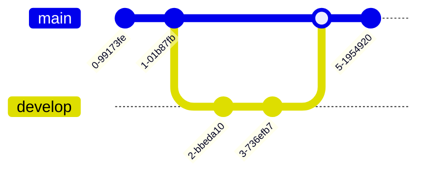

# Markdown Viewer Enhanced — 综合测试文档

> 本文件用于全面测试 Markdown Viewer Enhanced 的各项渲染能力，覆盖基础语法、扩展语法及边界况。

---

## 目录

- [1. 标题层级](#1-%E6%A0%87%E9%A2%98%E5%B1%82%E7%BA%A7)
- [2. 文本格式](#2-%E6%96%87%E6%9C%AC%E6%A0%BC%E5%BC%8F)
- [3. 链接与图片](#3-%E9%93%BE%E6%8E%A5%E4%B8%8E%E5%9B%BE%E7%89%87)
- [4. 列表](#4-%E5%88%97%E8%A1%A8)
- [5. 引用](#5-%E5%BC%95%E7%94%A8)
- [6. 高亮块（GitHub 风格告警）](#6-%E9%AB%98%E4%BA%AE%E5%9D%97github-%E9%A3%8E%E6%A0%BC%E5%91%8A%E8%AD%A6)
- [7. 代码块](#7-%E4%BB%A3%E7%A0%81%E5%9D%97)
- [8. 表格](#8-%E8%A1%A8%E6%A0%BC)
- [9. 数学公式](#9-%E6%95%B0%E5%AD%A6%E5%85%AC%E5%BC%8F)
- [10. Mermaid 图表](#10-mermaid-%E5%9B%BE%E8%A1%A8)
- [11. 任务列表](#11-%E4%BB%BB%E5%8A%A1%E5%88%97%E8%A1%A8)
- [12. 脚注](#12-%E8%84%9A%E6%B3%A8)
- [13. 定义列表](#13-%E5%AE%9A%E4%B9%89%E5%88%97%E8%A1%A8)
- [14. 上下标](#14-%E4%B8%8A%E4%B8%8B%E6%A0%87)
- [15. 分隔线](#15-%E5%88%86%E9%9A%94%E7%BA%BF)
- [16. HTML 内嵌](#16-html-%E5%86%85%E5%B5%8C)
- [17. 折叠内容](#17-%E6%8A%98%E5%8F%A0%E5%86%85%E5%AE%B9)
- [18. Emoji 表情](#18-emoji-%E8%A1%A8%E6%83%85)
- [19. 嵌套与组合](#19-%E5%B5%8C%E5%A5%97%E4%B8%8E%E7%BB%84%E5%90%88)
- [20. 特殊字符与转义](#20-%E7%89%B9%E6%AE%8A%E5%AD%97%E7%AC%A6%E4%B8%8E%E8%BD%AC%E4%B9%89)
- [21. 长文本段落测试](#21-%E9%95%BF%E6%96%87%E6%9C%AC%E6%AE%B5%E8%90%BD%E6%B5%8B%E8%AF%95)
- [22. 边界情况](#22-%E8%BE%B9%E7%95%8C%E6%83%85%E5%86%B5)

---

## 1. 标题层级

# 一级标题 H1

## 二级标题 H2

### 三级标题 H3

#### 四级标题 H4

##### 五级标题 H5

###### 六级标题 H6

# 备用 H1 写法

## 备用 H2 写法

---

## 2. 文本格式

### 2.1 基础样式

| 样式 | 语法 | 效果 |
| --- | --- | --- |
| 粗体 | **text** | 粗体文本 |
| 斜体 | *text* | 斜体文本 |
| 粗斜体 | ***text*** | 粗斜体文本 |
| 删除线 | ~~text~~ | 删除线文本 |
| 行内代码 | `code` | 行内代码 |
| 高亮 | ==text== | ==高亮文本== |
| 下划线(HTML) | <u>text</u> | 下划线文本 |
| 高亮(HTML) | <mark>text</mark> | 高亮文本 |

### 2.2 组合样式

- **粗体中嵌套 *斜体* 文本**
- *斜体中嵌套 **粗体** 文本*
- \*\*\*粗斜体中嵌套 ~~删除线~~ \*\*\*
- ~~删除线中嵌套 **粗体** 和 *斜体*~~
- **粗体中嵌套 `行内代码` 文本**
- 这是一段包含 **粗体**、*斜体*、~~删除线~~、`代码` 和 ==高亮== 的混合文本

### 2.3 长文本换行

这是一段很长的文本，用来测试渲染器对长行文本的处理能力。Markdown 中单个换行不会产生新段落，需要两个换行才能分段。这一行和上一行之间没有空行，所以它们应该在同一个段落中。

这是新的一段。上面有一个空行分隔。

这一行末尾有两个空格  
所以这里应该是一个软换行（`<br>`）。

---

## 3. 链接与图片

### 3.1 链接

- 行内链接：[GitHub](https://github.com)
- 带标题的链接：[Google](https://google.com "谷歌搜索")
- 自动链接：https://github.com
- 引用式链接：[Markdown 指南](https://www.markdownguide.org "Markdown Guide")
- 邮箱链接：[user@example.com](mailto:user@example.com)
- 纯 URL 自动识别：https://www.example.com

### 3.2 图片


带链接的图片：

[](https://github.com)

引用式图片：


---

## 4. 列表

### 4.1 无序列表

- 苹果
- 香蕉
  - 小香蕉
  - 大香蕉
- 橙子
  - 脐橙
    - 赣南脐橙
    - 秭归脐橙
      - 四级嵌套项

使用不同标记符号：

- 星号项目 1
- 星号项目 2


- 加号项目 1
- 加号项目 2


- 减号项目 1
- 减号项目 2

### 4.2 有序列表

1. 第一步：安装依赖
2. 第二步：配置环境
3. 第三步：启动项目
  1. 开发模式
  2. 生产模式
    1. 子子项 3.2.1
    2. 子子项 3.2.2
4. 第四步：验证

### 4.3 起始编号测试

3. 从 3 开始
4. 第四项
5. 第五项

### 4.4 列表中包含段落

1. 第一项

  这是第一项下面的段落内容，需要缩进对齐。

  这是第一项下面的第二个段落。

2. 第二项

  这是第二项下面的段落内容。

### 4.5 列表中包含其他元素

- 包含 **粗体** 和 *斜体* 的列表项

- 包含 `行内代码` 的列表项

- 包含 [链接](https://example.com) 的列表项

- 包含图片的列表项：小图标小图标

- 包含引用的列表项：

  > 这是列表中的引用

- 包含代码块的列表项：

  ```python
  print("列表中的代码块")
  ```

---

## 5. 引用

### 5.1 基础引用

> 这是一段引用文本。
>
> — 鲁迅

### 5.2 多行引用

> 这是引用的第一行。  
> 这是引用的第二行。  
> 这是引用的第三行。

### 5.3 多级嵌套引用

> 一级引用
>
> > 二级引用
> >
> > > 三级引用
> > >
> > > > 四级引用

### 5.4 引用中包含其他元素

> ### 引用中的标题
>
> 引用中的段落文本，包含 **粗体** 和 *斜体*。
>
> - 引用中的列表项 1
> - 引用中的列表项 2
>
> ```javascript
> // 引用中的代码块  
> console.log("Hello from blockquote!");  
> ```
>
> | 列1 | 列2 |
> | --- | --- |
> | A | B |
>
> 💡 提示：引用块中也可以包含 **粗体**、*斜体*、`代码`、[链接](https://example.com) 等格式。

---

## 6. 高亮块（GitHub 风格告警）

GitHub 风格的告警/高亮块，使用 `> [!TYPE]` 语法，支持 6 种类型：

### 信息 (NOTE)

> [!NOTE]
> 这是一条**信息**提示。用于补充说明读者需要了解的背景知识。
>
> 支持多行内容和 Markdown 格式：`代码`、*斜体*、[链接](https://example.com)。

### 说明 (IMPORTANT)

> [!IMPORTANT]
> 这是一条**重要说明**。用于强调关键信息，确保读者不会遗漏。
>
> 例如：API 密钥必须在环境变量中配置，切勿硬编码到源代码中。

### 提示 (TIP)

> [!TIP]
> 这是一条**小提示**。用于分享最佳实践或快捷操作。
>
> 在 VS Code 中按 `Ctrl + Shift + P` 打开命令面板，输入 `Reload` 可快速重载窗口。

### 警告 (WARNING)

> [!WARNING]
> 这是一条**警告信息**。用于提醒可能导致问题的操作。
>
> 直接修改 `node modules` 中的文件不会被版本控制跟踪，下次 `npm install` 后修改将丢失。

### 错误 (CAUTION)

> [!CAUTION]
> 这是一条**危险警告**。用于标识可能造成数据丢失或不可逆操作。
>
> 执行 `git reset --hard` 将**永久丢弃**所有未提交的更改，此操作不可撤销！

### 空白高亮块 (BLANK)

> 这是一个**无类型高亮块**，使用中性的灰色样式。
>
> 适用于不需要特定语义、仅需视觉区分的引用内容。

---

## 7. 代码块

### 7.1 行内代码

使用 `console.log()` 输出日志。变量 `let x = 42` 的值是 42。

行内代码中包含反引号：``code`` 或 ``` code ```。

### 7.2 Lua

```lua
-- 定义一个简单的玩家类
local Player = {}
 
function Player:new(name, level)
    local obj = {
        name = name or "匿名",
        level = level or 1,
        score = 0
    }
    setmetatable(obj, self)
    self.__index = self
    return obj
end
 
function Player:addScore(points)
    self.score = self.score + points
    print(string.format("%s 获得 %d 分！", self.name, points))
end
 
-- 创建玩家并测试
local player = Player:new("小明", 11)
player:addScore(100)
 
if player.score >= 100 then
    print("恭喜晋级！")
end
```

### 7.3 C++

```cpp
#include <iostream>
#include <vector>
#include <algorithm>
#include <functional>
#include <memory>
#include <string_view>
 
// 观察者模式 - 事件系统
template<typename... Args>
class EventDelegate {
public:
    using FuncType = std::function<void(Args...)>;
 
    void Bind(FuncType func) {
        listeners_.push_back(std::move(func));
    }
 
    void Broadcast(Args... args) const {
        for (const auto& listener : listeners_) {
            listener(std::forward<Args>(args)...);
        }
    }
 
    void Clear() { listeners_.clear(); }
 
private:
    std::vector<FuncType> listeners_;
};
 
// 智能容器
template<typename T>
class SmartContainer {
public:
    void add(T&& item) {
        items_.emplace_back(std::forward<T>(item));
    }
 
    [[nodiscard]] size_t size() const noexcept { return items_.size(); }
 
    auto begin() { return items_.begin(); }
    auto end() { return items_.end(); }
 
private:
    std::vector<T> items_;
};
```

### 7.4 JavaScript

```javascript
// ES6+ 特性展示
class Animal {
  #name; // 私有字段
 
  constructor(name) {
    this.#name = name;
  }
 
  get info() {
    return `Animal: ${this.#name}`;
  }
 
  speak = () => {
    console.log(`${this.#name} makes a sound.`);
  };
}
 
// 防抖函数
function debounce(fn, delay = 300) {
  let timer = null;
  return function (...args) {
    clearTimeout(timer);
    timer = setTimeout(() => {
      fn.apply(this, args);
    }, delay);
  };
}
 
// async/await
async function fetchData(url) {
  try {
    const response = await fetch(url);
    const data = await response.json();
    return data?.results ?? [];
  } catch (error) {
    console.error(`Error: ${error.message}`);
  }
}
```

### 7.5 TypeScript

```typescript
interface ApiResponse<T> {
  data: T;
  status: number;
  message: string;
  timestamp: Date;
}
 
type UserRole = 'admin' | 'editor' | 'viewer';
 
interface User {
  id: string;
  name: string;
  role: UserRole;
  metadata?: Record<string, unknown>;
}
 
async function fetchUsers(): Promise<ApiResponse<User[]>> {
  const response = await fetch('/api/users');
  if (!response.ok) {
    throw new Error(`HTTP ${response.status}: ${response.statusText}`);
  }
  return response.json() as Promise<ApiResponse<User[]>>;
}
 
// 泛型工具函数
function groupBy<T, K extends string>(
  items: T[],
  keyFn: (item: T) => K
): Record<K, T[]> {
  return items.reduce((acc, item) => {
    const key = keyFn(item);
    (acc[key] ??= []).push(item);
    return acc;
  }, {} as Record<K, T[]>);
}
```

### 7.6 Python

```python
from dataclasses import dataclass
from typing import Optional, List
import asyncio
 
@dataclass
class User:
    """用户数据类"""
    name: str
    age: int
    email: Optional[str] = None
 
    def greet(self) -> str:
        return f"Hello, I'm {self.name}, {self.age} years old."
 
class TreeNode:
    """二叉树节点"""
    def __init__(self, val: int = 0, left=None, right=None):
        self.val = val
        self.left = left
        self.right = right
 
def inorder_traversal(root: Optional[TreeNode]) -> List[int]:
    """中序遍历二叉树"""
    if not root:
        return []
    return (
        inorder_traversal(root.left)
        + [root.val]
        + inorder_traversal(root.right)
    )
 
# 列表推导与字典推导
squares = {x: x**2 for x in range(10) if x % 2 == 0}
 
# 异步函数
async def main():
    users: List[User] = [
        User("Alice", 30, "alice@example.com"),
        User("Bob", 25),
    ]
    for user in users:
        print(user.greet())
 
asyncio.run(main())
```

### 7.7 Go

```go
package main
 
import (
    "context"
    "fmt"
    "sync"
    "time"
)
 
type Result struct {
    Value string
    Err   error
}
 
func worker(ctx context.Context, id int, jobs <-chan string, results chan<- Result) {
    for job := range jobs {
        select {
        case <-ctx.Done():
            results <- Result{Err: ctx.Err()}
            return
        default:
            time.Sleep(100 * time.Millisecond)
            results <- Result{Value: fmt.Sprintf("Worker %d processed: %s", id, job)}
        }
    }
}
 
func main() {
    ctx, cancel := context.WithTimeout(context.Background(), 5*time.Second)
    defer cancel()
 
    jobs := make(chan string, 10)
    results := make(chan Result, 10)
 
    var wg sync.WaitGroup
    for i := 0; i < 3; i++ {
        wg.Add(1)
        go func(id int) {
            defer wg.Done()
            worker(ctx, id, jobs, results)
        }(i)
    }
 
    tasks := []string{"task-a", "task-b", "task-c", "task-d", "task-e"}
    for _, t := range tasks {
        jobs <- t
    }
    close(jobs)
 
    go func() {
        wg.Wait()
        close(results)
    }()
 
    for r := range results {
        if r.Err != nil {
            fmt.Printf("Error: %v\n", r.Err)
        } else {
            fmt.Println(r.Value)
        }
    }
}
```

### 7.8 Rust

```rust
use std::collections::HashMap;
 
#[derive(Debug, Clone)]
struct Config {
    name: String,
    values: HashMap<String, i64>,
}
 
impl Config {
    fn new(name: &str) -> Self {
        Config {
            name: name.to_string(),
            values: HashMap::new(),
        }
    }
 
    fn set(&mut self, key: &str, value: i64) -> &mut Self {
        self.values.insert(key.to_string(), value);
        self
    }
 
    fn get(&self, key: &str) -> Option<&i64> {
        self.values.get(key)
    }
}
 
fn main() {
    let mut config = Config::new("app");
    config.set("timeout", 30).set("retries", 3);
 
    if let Some(timeout) = config.get("timeout") {
        println!("Timeout: {}s", timeout);
    }
 
    // 迭代器链
    let sum: i64 = (1..=100)
        .filter(|x| x % 2 == 0)
        .map(|x| x * x)
        .sum();
    println!("Sum of even squares: {}", sum);
}
```

### 7.9 JSON

```json
{
  "name": "markdown-viewer-enhanced",
  "version": "1.0.0",
  "description": "增强型 Markdown 查看器",
  "features": ["代码高亮", "数学公式", "Mermaid 图表"],
  "config": {
    "theme": "auto",
    "fontSize": 16,
    "lineNumbers": true
  },
  "nullValue": null,
  "score": 99.5
}
```

### 7.10 YAML

```yaml
# 配置文件示例
server:
  host: 0.0.0.0
  port: 8080
  ssl:
    enabled: true
    cert: /path/to/cert.pem
 
database:
  driver: postgresql
  connection:
    host: localhost
    port: 5432
    name: mydb
  pool:
    min: 5
    max: 20
 
logging:
  level: info
  outputs:
    - type: console
      format: json
    - type: file
      path: /var/log/app.log
      rotate: daily
```

### 7.11 SQL

```sql
-- 复杂查询示例
WITH ranked_users AS (
    SELECT
        u.id,
        u.name,
        u.email,
        COUNT(o.id) AS order_count,
        SUM(o.total_amount) AS total_spent,
        ROW_NUMBER() OVER (
            PARTITION BY u.region
            ORDER BY SUM(o.total_amount) DESC
        ) AS rank_in_region
    FROM users u
    LEFT JOIN orders o ON u.id = o.user_id
    WHERE u.created_at >= '2024-01-01'
    GROUP BY u.id, u.name, u.email, u.region
    HAVING COUNT(o.id) > 0
)
SELECT * FROM ranked_users
WHERE rank_in_region <= 10
ORDER BY total_spent DESC;
```

### 7.12 Protocol Buffers

```proto
syntax = "proto3";
 
package game.projectt;
 
option go_package = "projectt/pb";
 
// 道具定义
message Item {
  uint32 item_id = 1;
  int32 count = 2;
  int64 expire_time = 3;
  map<string, string> extra_attrs = 4;
}
```

### 7.13 Shell

```bash
#!/bin/bash
set -euo pipefail
 
# 变量与函数
readonly LOG_FILE="/var/log/deploy.log"
DEPLOY_ENV="${1:-production}"
 
log() {
    local level="$1"; shift
    echo "[$(date '+%Y-%m-%d %H:%M:%S')] [$level] $*" | tee -a "$LOG_FILE"
}
 
deploy() {
    log "INFO" "Starting deployment to $DEPLOY_ENV..."
 
    if [[ "$DEPLOY_ENV" == "production" ]]; then
        log "WARN" "Production deployment - extra caution!"
        read -rp "Continue? (y/N): " confirm
        [[ "$confirm" =~ ^[Yy]$ ]] || { log "INFO" "Aborted."; exit 0; }
    fi
 
    # 数组与循环
    local -a services=("api" "web" "worker")
    for svc in "${services[@]}"; do
        log "INFO" "Deploying $svc..."
        docker compose -f "docker-compose.${DEPLOY_ENV}.yml" up -d "$svc"
    done
 
    log "INFO" "Deployment complete!"
}
 
deploy "$@"
```

### 7.14 Diff

```diff
--- a/config.json
+++ b/config.json
@@ -1,7 +1,8 @@
 {
   "name": "my-app",
-  "version": "1.0.0",
+  "version": "1.1.0",
   "config": {
-    "debug": true
+    "debug": false,
+    "logLevel": "info"
   }
 }
```

### 7.15 无语言标记的代码块

```
这是一段没有指定语言的代码块。
纯文本内容，不会进行语法高亮。
    保留缩进和空格。
```

### 7.16 代码块中的长行

```
这是一行非常非常非常非常非常非常非常非常非常非常非常非常非常非常非常非常非常非常非常非常非常非常非常非常非常非常非常非常非常非常非常非常非常非常非常非常非常非常非常非常非常非常非常非常非常非常非常非常非常非常非常非常非常非常非常非常非常非常非常非常非常非常非常非常非常非常非常非常非常非常非常非常非常非常非常非常非常非常非常非常非常非常非常非常非常非常非常非常非常非常非常非常非常非常非常非常非常非常非常非常非常非常非常非常非常非常非常非常非常非常非常非常非常非常非常非常非常非常非常非常非常非常非常非常非常非常非常非常非常非常非常非常非常非常非常非常非常非常非常非常非常非常非常非常非常非常非常非常非常非常非常非常非常非常非常非常非常非常非常非常非常非常非常非常非常非常非常非常非常非常非常非常非常非常非常非常非常非常非常非常非常非常非常非常非常非常非常非常非常非常非常非常非常非常非常非常非常非常非常非常非常非常非常非常非常非常非常非常非常非常非常非常非常非常非常非常非常非常非常非常非常非常非常长的文本
```

## 8. 表格

### 8.1 基础表格

| 姓名 | 年龄 | 城市 |
| --- | --- | --- |
| 张三 | 28 | 北京 |
| 李四 | 32 | 上海 |
| 王五 | 25 | 广州 |

### 8.2 对齐方式

| 左对齐 | 居中对齐 | 右对齐 |
| --- | --- | --- |
| Left | Center | Right |
| 数据1 | 数据2 | 数据3 |
| 长文本内容 | 中等 | 短 |

### 8.3 包含格式的表格

| 功能 | 语法 | 示例 |
| --- | --- | --- |
| 粗体 | **text** | 加粗 |
| 斜体 | *text* | 倾斜 |
| 代码 | `code` | inline |
| 链接 | [text](url) | 点击 |
| 删除线 | ~~text~~ | 划掉 |

### 8.4 宽表格

| 列1 | 列2 | 列3 | 列4 | 列5 | 列6 | 列7 | 列8 | 列9 | 列10 |
| --- | --- | --- | --- | --- | --- | --- | --- | --- | --- |
| A1 | B1 | C1 | D1 | E1 | F1 | G1 | H1 | I1 | J1 |
| A2 | B2 | C2 | D2 | E2 | F2 | G2 | H2 | I2 | J2 |

### 8.5 单列表格

| 唯一列 |
| --- |
| 数据A |
| 数据B |
| 数据C |

### 8.6 长内容表格

| 描述 | 详情 |
| --- | --- |
| 短 | OK |
| 这是一段非常长的表格单元格内容，用来测试表格在包含大量文本时的渲染效果和自动换行能力 | 这也是一段比较长的内容，看看两列都很长时的表现 |

### 8.7 表格行交错样式测试

表格行的交错样式（斑马纹样式）有助于提高表格的可读性，特别是在行数较多的情况下：

| 序号 | 功能名称 | 状态 | 说明 |
| --- | --- | --- | --- |
| 1 | 标题渲染 | ✅ 已支持 | 支持 H1-H6 六级标题 |
| 2 | 代码高亮 | ✅ 已支持 | 支持多种编程语言语法高亮 |
| 3 | 数学公式 | ✅ 已支持 | 支持行内公式和块级公式 |
| 4 | Mermaid | ✅ 已支持 | 支持流程图、时序图等多种图表 |
| 5 | 表格渲染 | ✅ 已支持 | 支持对齐方式和复杂内容 |
| 6 | 任务列表 | ✅ 已支持 | 支持嵌套和格式化 |
| 7 | 脚注 | ✅ 已支持 | 支持引用式和行内脚注 |
| 8 | Emoji | ✅ 已支持 | 支持 GitHub 风格和 Unicode |
| 9 | 定义列表 | ✅ 已支持 | 支持多定义和嵌套 |
| 10 | 折叠内容 | ✅ 已支持 | 支持默认展开和嵌套 |

---

## 9. 数学公式

### 9.1 行内公式

爱因斯坦质能方程：$E = mc^2$

二次方程求根公式：$x = \frac{-b \pm \sqrt{b^2 - 4ac}}{2a}$

欧拉公式：$e^{i\pi} + 1 = 0$

勾股定理：$a^2 + b^2 = c^2$

### 9.2 块级公式

$$
\int_{-\infty}^{\infty} e^{-x^2} dx = \sqrt{\pi}
$$

$$
\sum_{n=1}^{\infty} \frac{1}{n^2} = \frac{\pi^2}{6}
$$

$$
\nabla \times \mathbf{E} = -\frac{\partial \mathbf{B}}{\partial t}
$$

$$
\begin{pmatrix}
a_{11} & a_{12} & a_{13} \\
a_{21} & a_{22} & a_{23} \\
a_{31} & a_{32} & a_{33}
\end{pmatrix}
\begin{pmatrix} x \\ y \\ z \end{pmatrix}
=
\begin{pmatrix} b_1 \\ b_2 \\ b_3 \end{pmatrix}
$$

---

## 10. Mermaid 图表

### 10.1 流程图





### 10.2 时序图



### 10.3 类图



### 10.4 状态图



### 10.5 甘特图



### 10.6 饼图



### 10.7 Git 图



---

## 11. 任务列表

### 11.1 基础任务列表

- [x] 已完成的任务
- [x] 另一个已完成的任务
- [ ] 未完成的任务
- [ ] 另一个未完成的任务

### 11.2 嵌套任务列表

- [x] 主任务 1
  - [x] 子任务 1.1
  - [ ] 子任务 1.2
  - [ ] 子任务 1.3
- [ ] 主任务 2
  - [x] 子任务 2.1
  - [ ] 子任务 2.2

### 11.3 带格式的任务列表

- [x] **重要任务**：完成 API 接口开发
- [ ] *可选任务*：优化性能
- [x] ~~已取消任务：旧版兼容~~
- [ ] 包含 `代码` 和 [链接](https://example.com) 的任务

---

## 12. 脚注

### 12.1 基础脚注

这是一段包含脚注的文本[^1](%E8%BF%99%E6%98%AF%E7%AC%AC%E4%B8%80%E4%B8%AA%E8%84%9A%E6%B3%A8%E7%9A%84%E5%86%85%E5%AE%B9%E3%80%82)。这里还有另一个脚注\[^2\]。

### 12.2 长脚注

这是一段引用了长脚注的文本[^long-note](%E8%BF%99%E6%98%AF%E4%B8%80%E4%B8%AA%E8%BE%83%E9%95%BF%E7%9A%84%E8%84%9A%E6%B3%A8%E5%86%85%E5%AE%B9%E3%80%82)。

### 12.3 行内脚注

这是行内脚注的示例^\[这是一个行内脚注，不需要单独定义\]。

---

## 13. 定义列表

### 13.1 基础定义列表

Markdown : 一种轻量级标记语言，用于格式化纯文本文档。

HTML : 超文本标记语言，用于创建网页。

### 13.2 多定义

Git : 一个分布式版本控制系统。 : 由 Linus Torvalds 于 2005 年创建。

### 13.3 长定义

API : 应用程序编程接口（Application Programming Interface），是一组定义了软件组件之间交互方式的协议和工具。API 允许不同的软件系统之间进行通信和数据交换。

### 13.4 包含格式的定义

**TypeScript** : TypeScript 是 JavaScript 的超集，添加了**静态类型检查**和其他特性。它由 *Microsoft* 开发和维护。详见 [官方文档](https://www.typescriptlang.org/)。

### 13.5 连续定义列表

CPU : 中央处理器

GPU : 图形处理器

RAM : 随机存取存储器

SSD : 固态硬盘

---

## 14. 上下标

### 14.1 上标

- 水的化学式：H\~2\~O（下标测试）
- 爱因斯坦方程：E = mc^2^
- 数学表达式：x^2^ + y^2^ = r^2^
- 商标符号：Markdown^TM^

### 14.2 下标

- 二氧化碳：CO\~2\~
- 水分子：H\~2\~O
- 化学方程式中的下标：C\~6\~H\~12\~O\~6\~

---

## 15. 分隔线

### 15.1 三种分隔线写法

使用三个连字符：

---

使用三个星号：

---

使用三个下划线：

---

### 15.2 分隔线与文本

上方文本

---

下方文本

### 15.3 多个连续分隔线

---

---

---

---

## 16. HTML 内嵌

### 16.1 文本样式

<span style="color:red">红色文本</span>、<span style="color:blue">蓝色文本</span>、<span style="color:green">绿色文本</span>

<font size="5">大号文本</font> 和 <font size="1">小号文本</font>

### 16.2 居中内容

**居中的标题**

这是一段居中的文本内容。

### 16.3 键盘按键

按下 <kbd>Ctrl</kbd> + <kbd>C</kbd> 复制，<kbd>Ctrl</kbd> + <kbd>V</kbd> 粘贴。

使用 <kbd>Ctrl</kbd> + <kbd>Shift</kbd> + <kbd>P</kbd> 打开命令面板。

### 16.4 其他 HTML 元素

<abbr title="HyperText Markup Language">HTML</abbr> 是网页的基础语言。

这是<sup>上标</sup>和<sub>下标</sub>的 HTML 写法。

---

## 17. 折叠内容

### 17.1 基础折叠

这是折叠内容的主体部分。

- 列表项 1
- 列表项 2
- 列表项 3

### 17.2 默认展开

这段内容默认是展开的，用户可以点击收起。

```javascript
console.log("折叠块中的代码");
```

### 17.3 嵌套折叠

外层内容。

内层内容，这是嵌套的折叠块。

### 17.4 包含丰富内容的折叠

#### 接口说明

| 方法 | 路径 | 描述 |
| --- | --- | --- |
| GET | /api/users | 获取用户列表 |
| POST | /api/users | 创建用户 |
| PUT | /api/users/:id | 更新用户 |
| DELETE | /api/users/:id | 删除用户 |

> **注意**：所有接口需要携带 Bearer Token 进行认证。

```json
{
  "code": 200,
  "message": "success",
  "data": []
}
```

---

## 18. Emoji 表情

### 18.1 GitHub 风格 Emoji

😄 ❤️ 👍 🚀 ⭐ 🔥 🐛 📝 💡 ⚠️

✅ ❌ ✔️ ✖️

### 18.2 Unicode Emoji

😀 😃 😄 😁 😆 😅 🤣 😂 🙂 🙃 😉 😊 😇

🎉 🎊 🎈 🎁 🏆 🥇 🏅 🎯 🎮 🎲

👍 👎 👏 🙌 🤝 ✌️ 🤞 🤟 🤘 👌

❤️ 🧡 💛 💚 💙 💜 🖤 🤍 💔 ❣️

### 18.3 Emoji 在文本中

🚀 **项目已发布！** 感谢所有贡献者 🙏

⚠️ 注意：此操作不可撤销！

✅ 测试通过 | ❌ 测试失败 | ⏳ 测试中

📝 TODO: 完善文档 | 🐛 BUG: 修复登录问题 | ✨ FEAT: 新增搜索功能

---

## 19. 嵌套与组合

### 19.1 引用中的列表和代码

> **配置步骤：**
>
> 1. 安装依赖
>
>   ```bash
>   npm install  
>   ```
>
> 2. 修改配置文件
>
>   - 设置数据库连接
>   - 配置 API 密钥
>
> 3. 启动服务
>
>   ```bash
>   npm start  
>   ```

### 19.2 列表中的引用和代码

1. 第一步：理解需求

  > 需求文档中明确指出：系统需要支持多语言。

2. 第二步：编写代码

  ```python
  def greet(lang):
      messages = {"en": "Hello", "zh": "你好", "ja": "こんにちは"}
      return messages.get(lang, "Hello")
  ```

3. 第三步：编写测试

  - 单元测试
  - 集成测试
  - E2E 测试

### 19.3 表格中的复杂内容

| 特性 | 描述 | 示例 |
| --- | --- | --- |
| 粗体链接 | 加粗的超链接 | GitHub |
| 斜体代码 | 斜体中的代码 | 使用 map() 函数 |
| 组合格式 | 多种格式混合 | 复杂格式 |
| 图片 | 表格中的图片 |   |

### 19.4 多层嵌套引用与列表

> 外层引用
>
> > 内层引用
> >
> > - 列表项 A
> >   - 子项 A.1
> >
> >     > 更深层的引用
> >
> >   - 子项 A.2
> > - 列表项 B

---

## 20. 特殊字符与转义

### 20.1 Markdown 特殊字符转义

以下字符在 Markdown 中有特殊含义，需要使用反斜杠转义：

\* 星号 \* | \_ 下划线 \_ | # 井号 | + 加号 | - 减号 | . 点号 | ! 感叹号

\[ 方括号 \] | ( 圆括号 ) | { 花括号 } | \` 反引号 | | 管道符 | \\ 反斜杠

### 20.2 HTML 实体

- 版权符号：©
- 注册商标：®
- 商标：™
- 小于号：<
- 大于号：>
- 与号：&
- 不间断空格：a   b（多个空格）
- 破折号：—
- 省略号：…

### 20.3 特殊 Unicode 字符

- 箭头：← → ↑ ↓ ↔ ⇐ ⇒ ⇑ ⇓
- 数学：± × ÷ ≠ ≈ ≤ ≥ ∞ ∑ ∏ √ ∫
- 货币：$ € £ ¥ ₹ ₽ ₿
- 音乐：♩ ♪ ♫ ♬
- 棋牌：♠ ♣ ♥ ♦ ♔ ♕ ♖ ♗ ♘ ♙
- 方块：■ □ ▪ ▫ ▲ △ ▼ ▽ ◆ ◇ ○ ● ◎

---

## 21. 长文本段落测试

### 21.1 中文长段落

在软件工程领域，代码审查（Code Review）是一种通过让其他开发者检查代码变更来提高代码质量的实践。代码审查不仅能够发现潜在的缺陷和安全漏洞，还能促进团队成员之间的知识共享，确保代码风格的一致性，并帮助新成员更快地熟悉代码库。研究表明，经过代码审查的代码，其缺陷密度比未经审查的代码低 60% 以上。现代的代码审查工具（如 GitHub Pull Requests、GitLab Merge Requests、Gerrit 等）使得这一过程更加高效和便捷，支持行内评论、自动化检查、CI/CD 集成等功能。

### 21.2 英文长段落

Lorem ipsum dolor sit amet, consectetur adipiscing elit. Sed do eiusmod tempor incididunt ut labore et dolore magna aliqua. Ut enim ad minim veniam, quis nostrud exercitation ullamco laboris nisi ut aliquip ex ea commodo consequat. Duis aute irure dolor in reprehenderit in voluptate velit esse cillum dolore eu fugiat nulla pariatur. Excepteur sint occaecat cupidatat non proident, sunt in culpa qui officia deserunt mollit anim id est laborum. Curabitur pretium tincidunt lacus. Nulla gravida orci a odio. Nullam varius, turpis et commodo pharetra, est eros bibendum elit, nec luctus magna felis sollicitudin mauris.

---

## 22. 边界情况

### 22.1 空表格

|   |   |
| --- | --- |
|   |   |

### 22.2 只有标题的表格

| 列A | 列B | 列C |
| --- | --- | --- |

### 22.3 连续分隔线

---

---

---

### 22.4 特殊 URL

- 包含括号的链接：[Wikipedia](https://en.wikipedia.org/wiki/Markdown_(software))
- 包含中文的链接：[百度百科](https://baike.baidu.com/item/Markdown)
- 锚点链接：[回到顶部](#Markdown-Viewer-Enhanced%E2%80%94%E7%BB%BC%E5%90%88%E6%B5%8B%E8%AF%95%E6%96%87%E6%A1%A3)

### 22.5 超长单词

Pneumonoultramicroscopicsilicovolcanoconiosis 是英语中最长的单词之一。

`superlongvariablenamethatmightcauseoverflowissuesinnarrowcontainers`

### 22.6 连续格式切换

**粗体***斜体**粗斜体***~~删除~~`代码`**粗体**

### 22.7 空内容测试

**空粗体：** （紧跟空内容）

*空斜体：* （紧跟空内容）

### 22.8 列表编号不连续

1. 第一项
2. 第二项（源码写的也是 1）
3. 第三项（源码写的也是 1）

### 22.9 深层嵌套列表

- Level 1
  - Level 2
    - Level 3
      - Level 4
        - Level 5
          - Level 6
            - Level 7
              - Level 8

### 22.10 表格中的管道符

| 表达式 | 结果 |
| --- | --- |
| a | b | true |
| a | | error |

### 22.11 零宽字符

这里有一个零宽空格：「​」（U+200B），以及零宽连接符：「‍」（U+200D）。

### 22.12 RTL 文本

هذا نص باللغة العربية لاختبار اتجاه الكتابة من اليمين إلى اليسار.

---

## 测试清单总结

| # | 测试项 | 子项数 |
| --- | --- | --- |
| 1 | 标题层级 | 8 |
| 2 | 文本格式 | 3 |
| 3 | 链接与图片 | 3 |
| 4 | 列表 | 5 |
| 5 | 引用 | 4 |
| 6 | 高亮块（GitHub 风格告警） | 6 |
| 7 | 代码块 | 17 |
| 8 | 表格 | 6 |
| 9 | 数学公式 | 2 |
| 10 | Mermaid 图表 | 7 |
| 11 | 任务列表 | 3 |
| 12 | 脚注 | 3 |
| 13 | 定义列表 | 5 |
| 14 | 上下标 | 2 |
| 15 | 分隔线 | 3 |
| 16 | HTML 内嵌 | 4 |
| 17 | 折叠内容 | 4 |
| 18 | Emoji 表情 | 3 |
| 19 | 嵌套与组合 | 4 |
| 20 | 特殊字符与转义 | 3 |
| 21 | 长文本段落测试 | 2 |
| 22 | 边界情况 | 12 |
| 合计 | 22 大类 | ~103 子项 |

---

> 📝 **测试文档结束** — 以上内容覆盖了 Markdown 的全部主要语法特性及边界情况，可用于全面测试 Markdown Viewer Enhanced 的渲染效果。将此文件在不同的 Markdown 渲染器中打开（如 VS Code 预览、GitHub、Typora、Obsidian、GitLab、Notion 等），对比各渲染器的表现差异。

\[^2\]: 这是第二个脚注的内容，可以包含 **粗体** 和 *斜体*。

```
它可以包含多个段落，只需要缩进即可。

甚至可以包含代码块：`let x = 42;`
```