# 📋 完整语法与图表渲染测试文档

> 本文档覆盖 GFM（GitHub Flavored Markdown）全量语法 + YAML Front Matter + Mermaid / PlantUML / Graphviz 图表渲染，用于验证 MD Human Review 的渲染能力。

---

## 1. 标题层级

# 一级标题 H1
## 二级标题 H2
### 三级标题 H3
#### 四级标题 H4
##### 五级标题 H5
###### 六级标题 H6

---

## 2. 文本格式

**粗体文本** 和 *斜体文本* 和 ***粗斜体文本***

~~删除线文本~~ 和 ==高亮2文本==

^上标文本^ 和 ~下标文本~

++下划线文本++

{color:red}红色文本{/color} 和 {color:#4CAF50}绿色文本{/color} 和 {color:blue}蓝色文本{/color}

---

## 3. 链接与图片

### 3.1 链接

- 行内链接：[GitHub](https://github.com)
- 带标题的链接：[Google](https://google.com "谷歌搜索")
- 自动链接：https://www.example.com
- 引用式链接：[OpenSpec][openspec-link]

[openspec-link]: https://github.com/Fission-AI/OpenSpec "OpenSpec Framework"

### 3.2 图片


---

## 4. 列表

### 4.1 无序列表

- 苹果
  - 红富士
  - 青苹果
    - 澳洲青苹
- 香蕉
- 橙子

### 4.2 有序列表

1. 第一步：需求分析
2. 第二步：技术设计
   1. 架构设计
   2. 接口设计
3. 第三步：编码实现

### 4.3 任务列表

- [x] 项目初始化
- [x] 核心功能实现
- [ ] 单元测试编写
- [ ] 文档完善
  - [x] README
  - [ ] API 文档
  - [ ] 部署指南

### 4.4 定义列表

Markdown
: 一种轻量级标记语言，用于格式化纯文本文档。

GFM
: GitHub Flavored Markdown，GitHub 对标准 Markdown 的扩展。

---

## 5. 引用块

### 5.1 基本引用

> 这是一个引用块。
> 可以跨多行书写。

### 5.2 嵌套引用

> 第一层引用
> > 第二层嵌套引用
> > > 第三层嵌套引用

### 5.3 引用中的其他元素

> **注意**：引用块中可以包含其他 Markdown 元素：
>
> - 列表项 1
> - 列表项 2
>
> ```js
> console.log("引用中的代码块");
> ```

---

## 6. GitHub 风格告警块

> [!NOTE]
> 这是一个**注意**提示，用于补充说明信息。

> [!TIP]
> 这是一个**提示**，用于分享最佳实践建议。

> [!IMPORTANT]
> 这是一个**重要**提示，用于强调关键信息。

> [!WARNING]
> 这是一个**警告**提示，用于提醒潜在风险。

> [!CAUTION]
> 这是一个**注意**提示，用于标记危险操作。

---

## 7. 代码

### 7.1 行内代码

使用 `npm install` 安装依赖，运行 `npm test` 执行测试。

### 7.2 代码块（多语言高亮）

```javascript
// JavaScript - 斐波那契数列
function fibonacci(n) {
  if (n <= 1) return n;
  return fibonacci(n - 1) + fibonacci(n - 2);
}

const result = Array.from({ length: 10 }, (_, i) => fibonacci(i));
console.log(`Fibonacci: ${result.join(', ')}`);
```

```python
# Python - 快速排序
def quicksort(arr):
    if len(arr) <= 1:
        return arr
    pivot = arr[len(arr) // 2]
    left = [x for x in arr if x < pivot]
    middle = [x for x in arr if x == pivot]
    right = [x for x in arr if x > pivot]
    return quicksort(left) + middle + quicksort(right)

print(quicksort([3, 6, 8, 10, 1, 2, 1]))
```

```typescript
// TypeScript - 泛型接口
interface Repository<T> {
  getById(id: string): Promise<T>;
  save(entity: T): Promise<void>;
  delete(id: string): Promise<boolean>;
}

class UserRepository implements Repository<User> {
  async getById(id: string): Promise<User> {
    return await db.users.findOne({ id });
  }
  async save(user: User): Promise<void> {
    await db.users.upsert(user);
  }
  async delete(id: string): Promise<boolean> {
    return await db.users.remove({ id });
  }
}
```

```css
/* CSS - 渐变动画 */
.gradient-bg {
  background: linear-gradient(-45deg, #ee7752, #e73c7e, #23a6d5, #23d5ab);
  background-size: 400% 400%;
  animation: gradientShift 15s ease infinite;
}

@keyframes gradientShift {
  0% { background-position: 0% 50%; }
  50% { background-position: 100% 50%; }
  100% { background-position: 0% 50%; }
}
```

```sql
-- SQL - 复杂查询
SELECT 
    u.name,
    COUNT(o.id) AS order_count,
    SUM(o.total) AS total_spent
FROM users u
LEFT JOIN orders o ON u.id = o.user_id
WHERE u.created_at >= '2024-01-01'
GROUP BY u.id, u.name
HAVING COUNT(o.id) > 5
ORDER BY total_spent DESC
LIMIT 10;
```

```bash
#!/bin/bash
# Shell - 批量文件处理
for file in *.md; do
    echo "Processing: $file"
    wc -l "$file"
    sed -i 's/old_text/new_text/g' "$file"
done
echo "All files processed!"
```

```json
{
  "name": "md-human-review",
  "version": "1.0.0",
  "description": "Markdown review & annotation tool",
  "engines": {
    "vscode": "^1.74.0"
  },
  "categories": ["Education", "Visualization"]
}
```

### 7.3 Diff 代码块

```diff
- const oldFunction = () => {
-   return "deprecated";
- };
+ const newFunction = (param: string) => {
+   return `improved: ${param}`;
+ };
```

---

## 8. 表格

### 8.1 基本表格

| 功能 | 状态 | 说明 |
|------|:----:|------|
| Mermaid 渲染 | ✅ | 流程图、时序图、甘特图等 |
| PlantUML 渲染 | ✅ | 类图、时序图、用例图等 |
| Graphviz 渲染 | ✅ | DOT 语言有向图、无向图 |
| KaTeX 公式 | ✅ | 行内和块级数学公式 |
| 代码高亮 | ✅ | 多语言语法高亮 |

### 8.2 对齐方式

| 左对齐 | 居中对齐 | 右对齐 |
|:-------|:--------:|-------:|
| 内容1 | 内容2 | 内容3 |
| 左 | 中 | 右 |
| Long content here | Centered | ¥1,234.56 |

### 8.3 复杂表格

| 方法 | 路径 | 描述 | 权限 |
|------|------|------|------|
| `GET` | `/api/users` | 获取用户列表 | `read:users` |
| `POST` | `/api/users` | 创建新用户 | `write:users` |
| `PUT` | `/api/users/:id` | 更新用户信息 | `write:users` |
| `DELETE` | `/api/users/:id` | 删除用户 | `admin:users` |

---

## 9. 数学公式（KaTeX）

### 9.1 行内公式

质能方程 $E = mc^2$，欧拉公式 $e^{i\pi} + 1 = 0$，二次方程求根公式 $x = \frac{-b \pm \sqrt{b^2 - 4ac}}{2a}$。

### 9.2 块级公式

$$
\int_{-\infty}^{\infty} e^{-x^2} dx = \sqrt{\pi}
$$

$$
\sum_{n=1}^{\infty} \frac{1}{n^2} = \frac{\pi^2}{6}
$$

$$
\nabla \times \mathbf{E} = -\frac{\partial \mathbf{B}}{\partial t}
$$

$$
\begin{pmatrix}
a_{11} & a_{12} & a_{13} \\
a_{21} & a_{22} & a_{23} \\
a_{31} & a_{32} & a_{33}
\end{pmatrix}
\begin{pmatrix} x \\ y \\ z \end{pmatrix}
=
\begin{pmatrix} b_1 \\ b_2 \\ b_3 \end{pmatrix}
$$

---

## 10. 脚注

这是一个包含脚注的段落[^1]，还有另一个脚注[^note]。

[^1]: 这是第一个脚注的内容。
[^note]: 这是一个命名脚注，支持**富文本格式**和 `代码`。

---

## 11. 分隔线

以下三种方式均可创建分隔线：

---

***

___

---

## 12. HTML 内联元素

<details>
<summary>点击展开折叠内容</summary>

这是折叠区域内的内容。

- 支持 Markdown 语法
- **粗体** 和 *斜体*
- `代码` 片段

```python
print("折叠块中的代码")
```

</details>

<kbd>Ctrl</kbd> + <kbd>Shift</kbd> + <kbd>P</kbd> 打开命令面板

---

## 13. Emoji :rocket:

:thumbsup: :heart: :star: :fire: :warning: :bug: :tada: :rocket: :sparkles: :memo:

---

## 14. Mermaid 图表

### 14.1 流程图

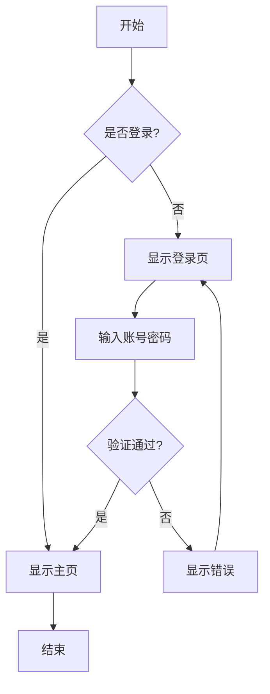

### 14.2 时序图

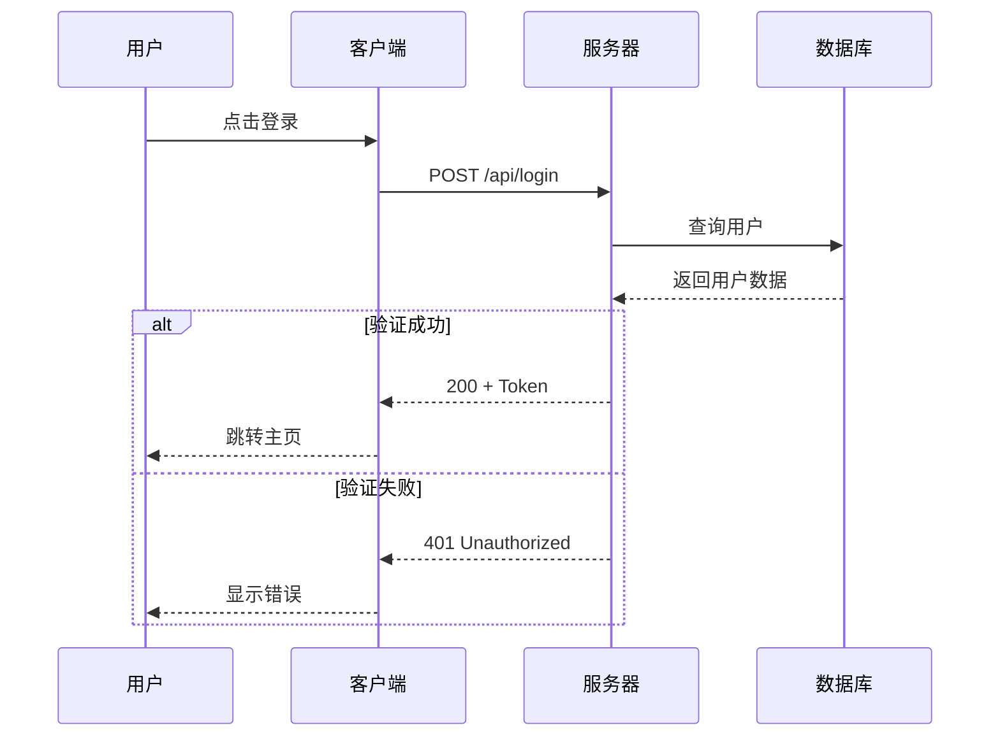

### 14.3 甘特图

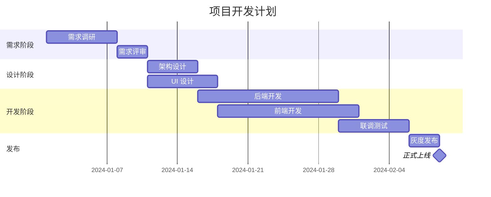

### 14.4 类图

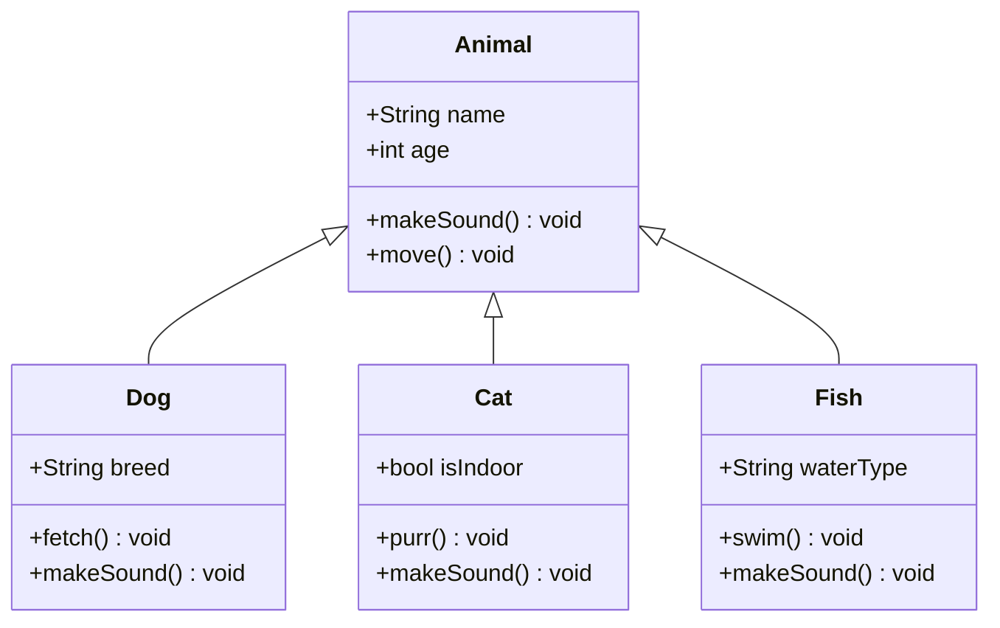

### 14.5 状态图

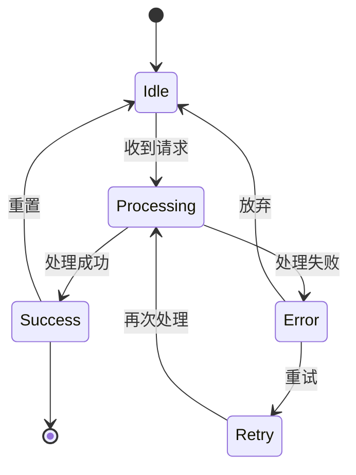

### 14.6 饼图

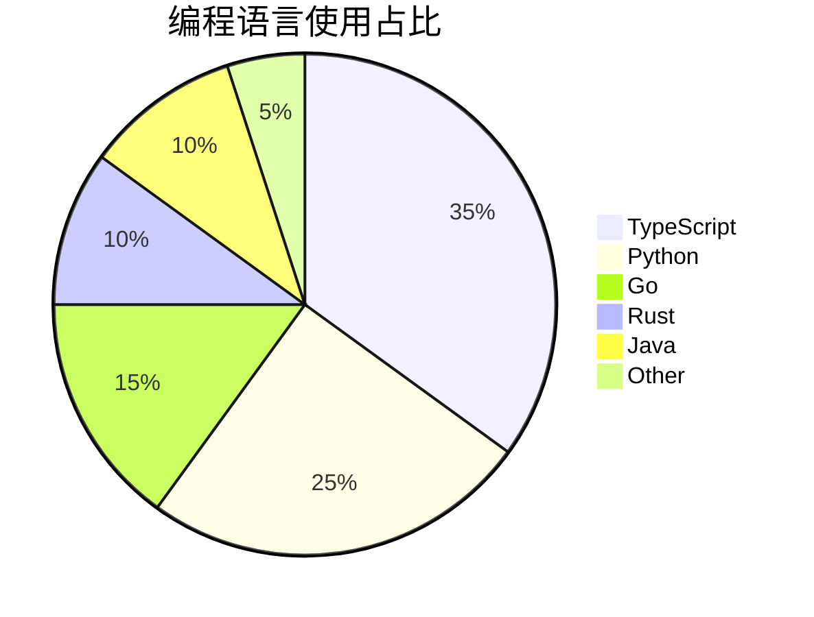

### 14.7 ER 图

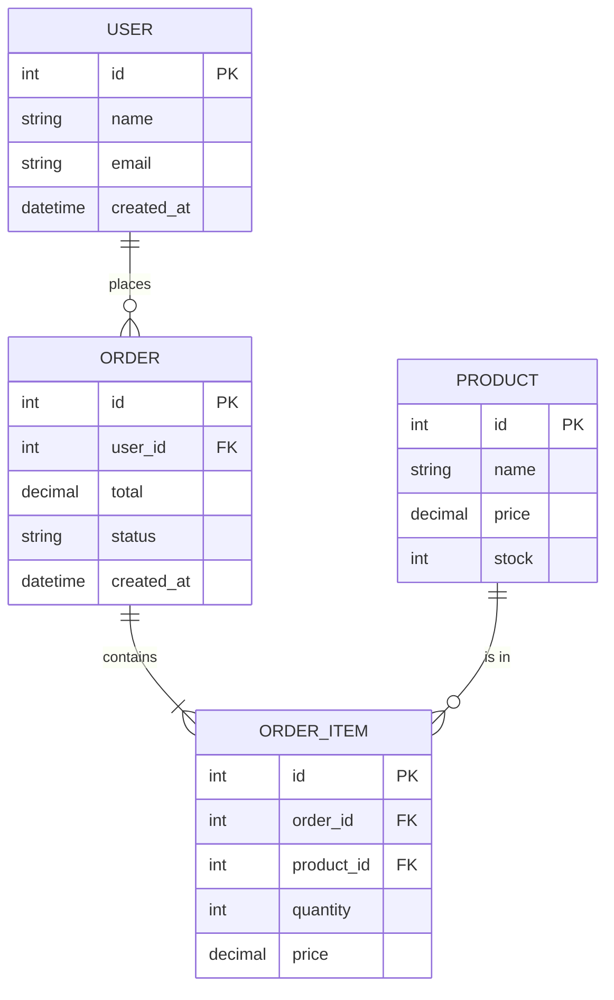

---

## 15. PlantUML 图表

### 15.1 类图

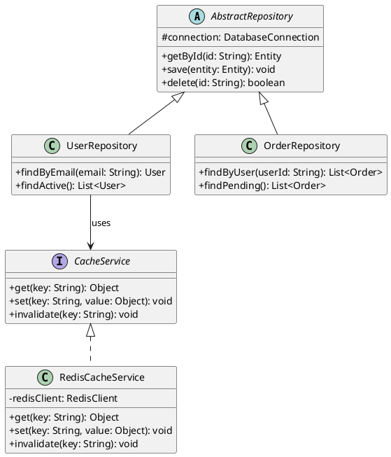

### 15.2 时序图

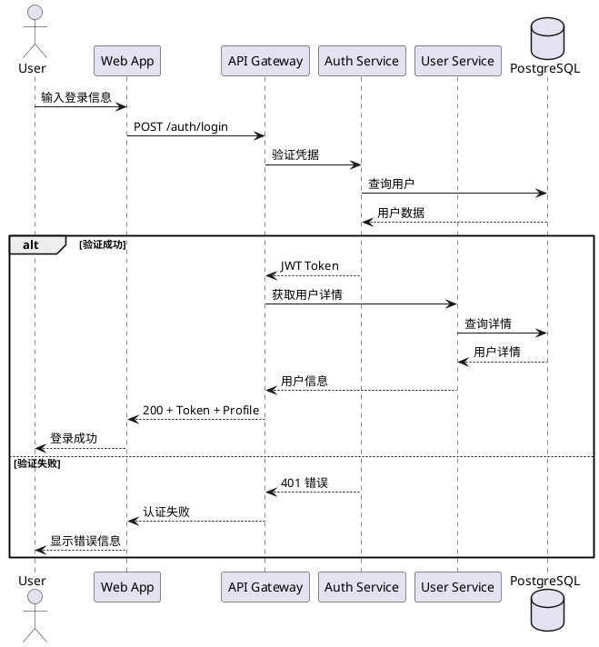

### 15.3 用例图

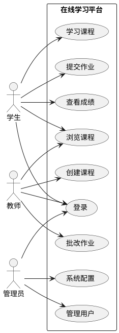

### 15.4 活动图

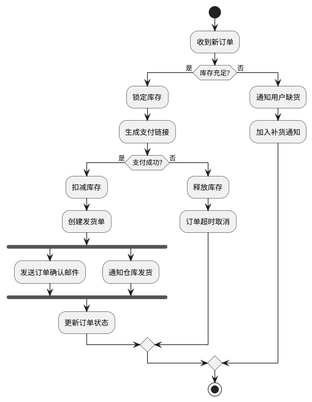

### 15.5 组件图

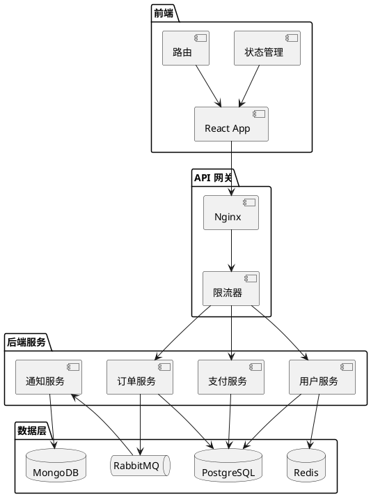

---

## 16. Graphviz 图表

### 16.1 有向图 - 软件架构

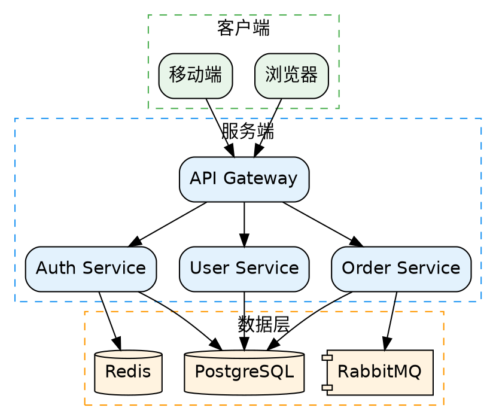

### 16.2 有向图 - 工作流

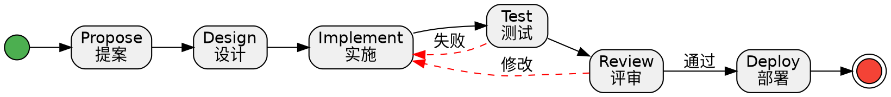

### 16.3 无向图 - 网络拓扑

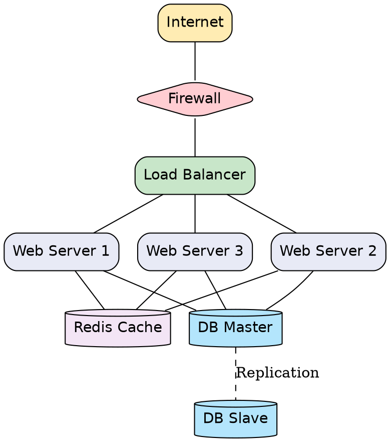

### 16.4 有向图 - Git 分支模型

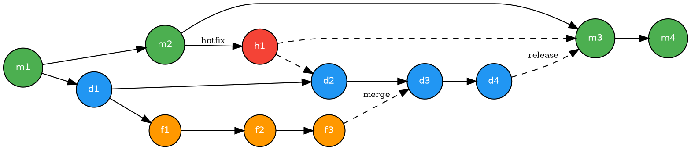

---

## 17. 混合内容测试

### 引用中的公式和代码

> **欧拉恒等式** 被认为是数学中最优美的公式：
>
> $$e^{i\pi} + 1 = 0$$
>
> 它将五个最重要的数学常数 $e$、$i$、$\pi$、$1$、$0$ 联系在一起。
>
> 在代码中可以这样验证：
> ```python
> import cmath
> result = cmath.exp(complex(0, cmath.pi)) + 1
> print(f"Result: {result}")  # ≈ 0
> ```

### 表格中的代码和格式

| 表达式 | 结果 | 说明 |
|--------|------|------|
| `2 ** 10` | 1024 | 2 的 10 次方 |
| `Math.PI` | 3.14159... | 圆周率 $\pi$ |
| `0.1 + 0.2` | 0.30000...4 | **浮点精度** 问题 |

### 告警块中的列表和链接

> [!TIP]
> 推荐使用以下工具进行 Markdown 开发：
> - [VS Code](https://code.visualstudio.com/) + MD Human Review 扩展
> - [marked.js](https://marked.js.org/) 作为解析器
> - [mermaid.js](https://mermaid.js.org/) 绘制图表
> - [KaTeX](https://katex.org/) 渲染数学公式

---

## 18. 长文本压力测试

Lorem ipsum dolor sit amet, consectetur adipiscing elit. Sed do eiusmod tempor incididunt ut labore et dolore magna aliqua. Ut enim ad minim veniam, quis nostrud exercitation ullamco laboris nisi ut aliquip ex ea commodo consequat. Duis aute irure dolor in reprehenderit in voluptate velit esse cillum dolore eu fugiat nulla pariatur. Excepteur sint occaecat cupidatat non proident, sunt in culpa qui officia deserunt mollit anim id est laborum.

中文长段落测试：天地玄黄，宇宙洪荒。日月盈昃，辰宿列张。寒来暑往，秋收冬藏。闰余成岁，律吕调阳。云腾致雨，露结为霜。金生丽水，玉出昆冈。剑号巨阙，珠称夜光。果珍李柰，菜重芥姜。海咸河淡，鳞潜羽翔。龙师火帝，鸟官人皇。始制文字，乃服衣裳。推位让国，有虞陶唐。吊民伐罪，周发殷汤。坐朝问道，垂拱平章。爱育黎首，臣伏戎羌。

---

## 19. 特殊字符与转义

\*这不是斜体\* \**这不是粗体\** \[这不是链接\]

HTML 实体：&amp; &lt; &gt; &quot; &copy; &reg; &trade;

箭头：← → ↑ ↓ ↔ ⇐ ⇒ ⇑ ⇓

数学符号：± × ÷ ≠ ≤ ≥ ∞ ∑ ∏ √ ∫

方框：■ □ ▪ ▫ ● ○ ◆ ◇ ★ ☆

---

> **文档结束** — 如果以上所有元素均正确渲染，说明 MD Human Review 的渲染能力已覆盖 GFM 全量语法及主流图表格式。
